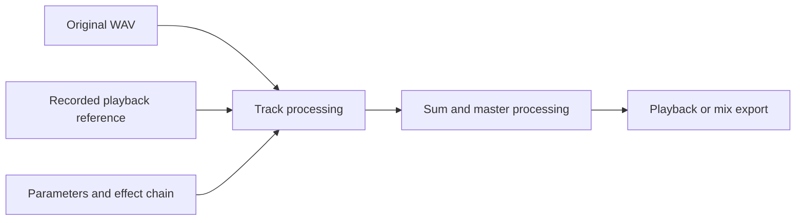

# Modeling and architecture

My Audio models a musical sketch as a project containing tracks, notes, a metronome, a playback loop and a master effect chain. Each track owns one recording/import and its processing parameters. Stopping a take saves a new track. There are no freely arranged clip segments or take lists: the model follows the direct recording workflow.

The typed Kotlin model in [Project.kt](../shared/src/commonMain/kotlin/com/martensening/my_audio/data/Project.kt) expresses `Project`, `Track`, `TrackEffects`, `EffectSlot` and `ChainEffect`. [Requirements](app-requirements.md) define behavior; the [data format](data-format.md) defines persistence.

## Separate source, intent and result

Original WAV files remain immutable after saving. JSON records editing intent: gain, pan/balance, envelopes, normalization and ordered effect parameters. Rendering derives audible output from these inputs.

An overdub reference records exactly the playback heard during that take, excluding the metronome. Later mix edits do not invalidate it; today's mix cannot substitute for that observation. Cleaned audio is a disposable, algorithm-versioned cache. Backups carry originals, references and parameters, excluding derived caches. New takes have click/bleed removal disabled, but retain the reference for optional processing.

## One timeline, measured in frames

Projects use 48 kHz audio frames. A stereo frame contains both simultaneous channel samples; duration is not doubled by the channel count. Offsets, loops and envelope points share this time base. A take's stored offset incorporates the measured device latency and recorded count-in, so the file can begin before project frame zero without rewriting audio. Recalibration never shifts existing takes.

`channels` distinguishes mono recordings from stereo imports. `pan` positions mono; for stereo it attenuates the opposite channel as balance without folding the channels together. Waveforms use channel peaks rather than averaging potentially opposing signals.

## Ordered effect data

Each slot has a stable effect type, parameters and a bypass flag. Bypass preserves values. Track and master chains share the slot model and each allow six entries. Airwindows IDs use stable names rather than catalogue positions. Unknown Airwindows names remain stored but are not rendered by a build that lacks them.

The device-local library selection controls which effects the add dialog offers; it does not remove effects already stored in projects. Signal order is cleanup → normalization → track chain → gain/envelope/pan, then summed tracks → master chain → fixed loudness/limiter. See [TrackProcessing.cpp](../app/src/main/cpp/TrackProcessing.cpp) and [ProjectMix.cpp](../app/src/main/cpp/ProjectMix.cpp).

## Real-time transport and offline rendering

Expensive track/effect processing prepares audio before playback or overdubbing. The real-time callback handles capture, prepared playback and metronome generation. [EffectPreview.cpp](../app/src/main/cpp/EffectPreview.cpp) uses the same processing for short clips played by a separate looping preview player. A/B bypasses one effect while keeping the rest of the chain. Live input monitoring with effects is separate open work.

## Shared musical logic, explicit platform services

Android and Windows share the project model, UI, [ProjectSession](../shared/src/jvmSharedMain/kotlin/com/martensening/my_audio/ui/ProjectSession.kt) and native offline processing. [ProjectPlatform](../shared/src/jvmSharedMain/kotlin/com/martensening/my_audio/ui/ProjectPlatform.kt) describes services such as routing, calibration, background operation and encoding. Oboe/miniaudio and OS permissions, dialogs and sharing remain platform-specific.

## Persistence and compatibility

Optional fields have explicit defaults. Meaning changes require versioning and load-time migration. Writers select the lowest required format: 1 for mono without chains, 2 for stereo, 3 for effect chains. Fixed EQ/compressor/reverb fields in formats 1/2 migrate into slots without rewriting source audio. Untouched projects are not resaved merely by opening them.

Format, backup and migration tests under [shared desktop tests](../shared/src/desktopTest/) check compatibility. Native tests check signal behavior. Listening on real hardware remains a separate kind of evidence.
