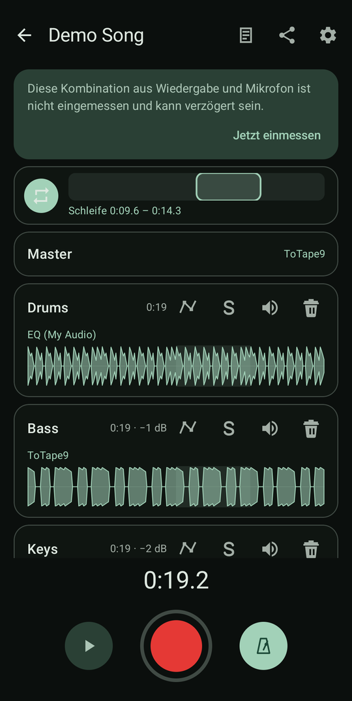
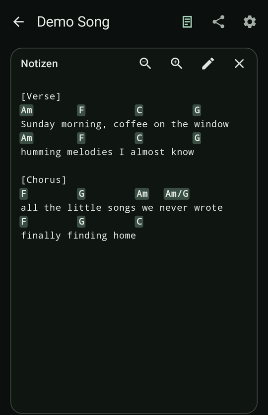
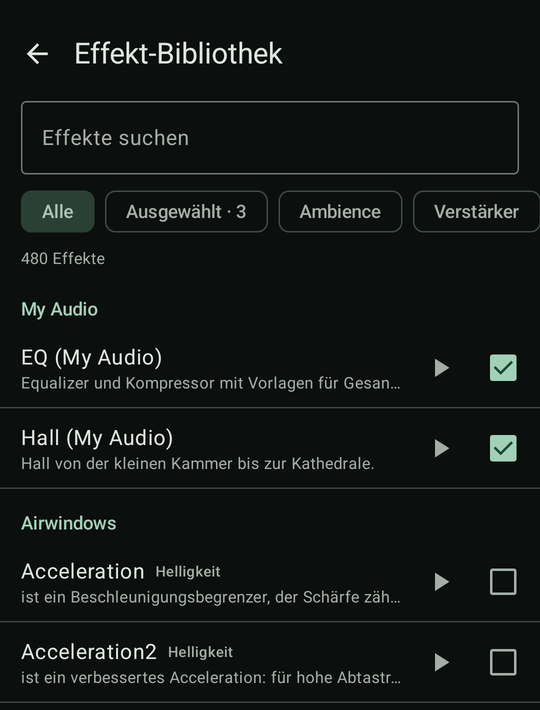

<p align="center">
  
</p>

<h1 align="center">My Audio</h1>

<p align="center">
  <b>A studio from your smartphone. Your idea. Your demo.</b><br>
  Multitrack sketches with effects on Android and Windows – local, free and open source.
</p>

<p align="center">
  <a href="https://github.com/bmartensen/my-audio/releases/latest">Download</a> ·
  <a href="https://bmartensen.github.io/my-audio/en/guide/">User guide</a> ·
  <a href="https://bmartensen.github.io/my-audio/de/guide/">Anleitung</a> ·
  <a href="CHANGELOG.md">Changelog</a> ·
  <a href="LICENSE">MIT License</a>
</p>

<p align="center">
  
  &nbsp;
  
  &nbsp;
  
</p>

My Audio captures musical ideas as multitrack sketches: record a melody, add a guitar part or a second voice over it, try effects and share the mix. It favours a direct path from idea to demo over the depth of a professional audio workstation.

## Features

- **Calibrated overdubbing** – existing tracks play while a new one records; the measured round-trip latency keeps takes aligned, even over the built-in speaker and microphone.
- **Live effects** – hear yourself through a track's effects while recording; takes always stay dry and non-destructive.
- **Mixing** – volume, pan/balance, volume envelopes, solo/mute and a practice loop; up to six effects per track and on the master, including 478 [Airwindows](https://www.airwindows.com/) effects with looping A/B previews.
- **Practice tools** – metronome with count-in, silent pre-roll, guitar tuner and song notes with chord highlighting and teleprompter scrolling.
- **Import and sharing** – MP3, Ogg and WAV import in mono or stereo; share an Ogg/Opus mix, aligned WAV stems or a complete project backup.
- **Private by design** – no account, no network service, no tracking. English and German, light and dark themes.

## Install

Download the signed Android APK (Android 10+) or the Windows installer (Windows 10/11, x64) from the [latest release](https://github.com/bmartensen/my-audio/releases/latest), together with SHA-256 checksums. The [user guide](https://bmartensen.github.io/my-audio/en/guide/) explains installation and every screen.

## Build from source

On Windows x64, in PowerShell from the checkout:

```powershell
.\build.ps1 -Target All -Check          # inspect prerequisites, change nothing
.\build.ps1 -Target All -InstallTools   # install missing tools, build APK and MSI
```

The helper finds or installs JDK 21, the pinned Android SDK/NDK/CMake packages and the Visual Studio C++ Build Tools. Android Studio and Python are optional. Use `-Target Android` or `-Target Windows` for one platform; artifacts and checksums go to `.work/`.

No publisher credentials are needed: debug APKs use Android's local debug key and development installers are unsigned. Signing with your own key, distribution notes and test commands are in [developer builds](.wiki/developer-builds.md) and [repository commands](.wiki/repository-rules.md).

## Architecture

Kotlin and Compose Multiplatform share the UI, project model and session logic. A C++ engine shares mixing and effects, with Oboe on Android and miniaudio on Windows.

| Directory | Contents |
|---|---|
| [`shared/`](shared/) | Project model, UI, session logic and resources |
| [`app/`](app/) | Android host and Oboe; shared native processing in `src/main/cpp` |
| [`desktop/`](desktop/) | Windows host, miniaudio and installer |
| [`docs/`](docs/) | GitHub Pages: landing pages, user guide, privacy policy and legal notice |
| [`tools/`](tools/) | Tool discovery, builds, native tests, screenshots and release checks |
| [`.wiki/`](.wiki/README.md) | Requirements, decisions, backlog and technical notes |

[Modeling](.wiki/modeling.md) covers immutable source audio, non-destructive processing, frame-based timing and the versioned project format.

## Contributing

Ideas, bug reports and pull requests are welcome. Project knowledge lives in the [wiki](.wiki/README.md): agreed behavior in [requirements](.wiki/app-requirements.md), choices in [decisions](.wiki/decisions.md) and open work in the [backlog](.wiki/backlog.md). Please read the [collaboration principles](.wiki/collaboration.md) first.

[`AGENTS.md`](AGENTS.md) is the shared policy for contributors and coding assistants; three shared workflows (`start`, `grill-me`, `wrap`) live in [`.agents/`](.agents/README.md).

## License and credits

Original My Audio code and documentation are licensed under the [MIT License](LICENSE). Third-party components and the preview sample keep their own licenses; see the [third-party notices](licenses/THIRD_PARTY_NOTICES.md) and [license texts](licenses/README.md), also shown in the app under **About → Open-source licenses**.

Thank you to the communities behind Kotlin, Compose, AndroidX, Google's Material Icons, Oboe, Airwindows and Airwin Consolidated, miniaudio, Opus, Skiko/Skia and OpenJDK, and to painted-panda for the CC0 preview music. This software is based in part on the work of the Independent JPEG Group.

<p align="center">
  <a href="https://bmartensen.github.io/my-audio/en/privacy/">Privacy policy</a> ·
  <a href="https://bmartensen.github.io/my-audio/en/legal/">Legal notice</a> ·
  <a href="https://www.martensening.com/myaudio/">martensening.com</a> ·
  <a href="branding/README.md">Branding</a>
</p>
